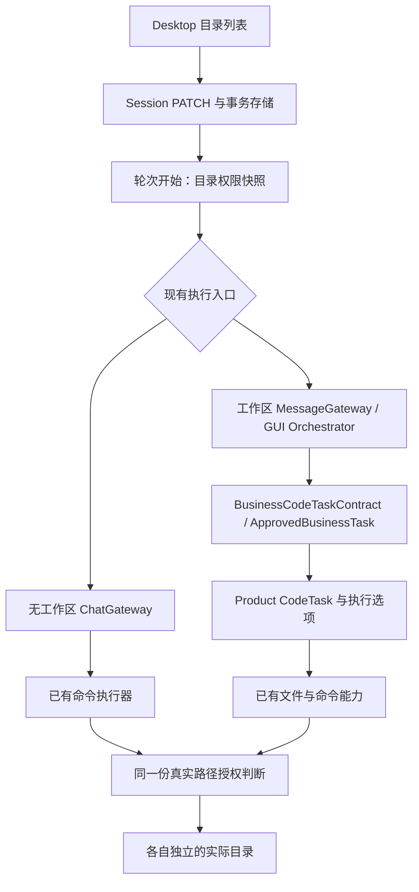

# CodeAgent Desktop：会话多目录授权重构详细设计

日期：2026-09-11。状态：设计完成，待实施。目标读者：负责 Desktop、Business Service、Product 与 Framework 的 AI IDE。

本文依据本次讨论、用户截图及当前工作树源码编写。本次只新增本文，未修改产品代码、用户配置或运行中的服务，未执行运行验收。文件中建议新增的类型、字段、错误码均为设计，不代表已存在。

## 1. 要解决的问题与完成标准

用户在 `petclinic` 会话中，已有目录：

```text
D:\project\workspace\spring-petclinic-microservices
```

再添加：

```text
D:\project\workspace\TestSemantic
```

开启第二个目录的“可编辑”后，模型应能够通过现有执行工具修改两个目录中的文件。第二个目录不必是第一个目录的子目录，不必注册成另一个工作区，也不必移动磁盘位置。不同磁盘、非 Git 目录遵循同样规则。

当前截图中的“下面的目录只作为模型上下文提示，不会改变上面的写入权限”，反映了两套数据并存的问题。只让新增路径保存成功，或只改面板名称，都不能完成本次改造。

本次采用：**会话保存一份目录列表，每个目录独立设置可编辑；实际写入范围取已授权目录的并集。工作区归属、默认命令执行目录和文件写入边界分别处理。**

完成标准为：UI 保存 → 数据库持久化 → 会话读取 → 轮次快照 → Product/Framework 执行 → 实际文件变更全部一致，原基础目录不能在后续任一层重新成为外部目录的限制。

## 2. 已确定的产品边界

1. 用户可见名称统一为“目录”，移除旧“当前会话合同”大卡片、意图、验证级别、版本与双目录摘要。面板提供添加、修改、移除和可编辑标签。
2. 目录入口位于消息区输入框上沿左端，与右侧 Git 对齐，保持浮动面板，不扩成固定第三列。
3. 工作区是会话的组织归属，不是所有会话目录必须包含于其中的物理根。现有工作区仍可关联原项目路径供默认执行、Git 与兼容使用，本次不要求先重写整个工作区系统。
4. 无工作区会话在完全访问关闭时默认只读；有工作区会话在完全访问关闭时使用目录授权。
5. **保留完全访问按钮。开启后不受工作区归属、目录列表和编辑开关限制，无工作区会话同样适用。** 关闭后恢复基础目录规则；不能把完全访问实现成原工作区中的 `.`。
6. **提示词、能力注册、工具注入集合和模型自主决策沿用现有行为。** 本次调整权限数据和已有执行器的路径处理，不设计新的提示词、不新增审批流程、不更改模型如何规划或选择工具。
7. 目录不是读取白名单。用户在消息中指定其他路径时，继续沿用现有读取行为；目录编辑开关只控制本方案涉及的写入授权。
8. 移除目录仅移除记录及其授权，绝不删除磁盘目录。新会话不自动复制当前会话目录；不恢复“沿用合同新会话”入口。

### 2.1 与已有文档的关系

| 文档 | 本次关系 |
|---|---|
| [原桌面重设计方案](2026-09-11-user-controlled-session-redesign-plan.md) | 保留其中无冲突的两列布局、用户控制和完全访问语义；本次明确多个独立目录的授权与落地方式 |
| [目录与工作区讨论稿](2026-09-11-directory-and-workspace-discussion.md) | 目录权限、父子重叠及保存交互以本文的详细决定为准；其余工作区导航讨论不扩大成本次前置改造 |
| 目录保存根因与旧实施方案（历史引用 `../../../docs/2026-09-11-directory-save-root-cause-and-implementation-plan.md`，当前文件未找到） | 其中“目录仅为上下文、不改变写权限、删除编辑开关”的方向被本次需求替代；其中错误可见、乐观锁、缓存及幂等处理经验仍可复用 |

保留历史文档，不执行其中的代码修改、数据清理或重启指令。后续实施可补充替代标记；不能把旧文档当成本次授权。

## 3. 当前实现核对

以下为当前源码事实，不是对用户正在运行的构建版本的断言。工作树已有多处未提交改动，实施前需重新核对方法，行号不作为固定依据。

### 3.1 BusinessAgentCode 内的链路

| 位置（仓库相对路径） | 当前行为 | 本次改造职责 |
|---|---|---|
| `apps/codeagent-desktop/src/renderer/app/DirectoryPanel.tsx` | 保存 `contextDirectories`；另展示 `writeAllow/writeForbid`；“恢复项目写入范围”使用 preflight 推荐路径 | 改为保存目录及编辑标记；移除旧卡片、修复按钮及其 preflight 依赖 |
| `apps/codeagent-desktop/src/renderer/app/queries.ts`、`data/historyQueries.ts` | SessionLike 及 metadata/detail 显式映射 | 增加权威目录字段与生效摘要，防止分页模式丢字段 |
| `business-agent-contract/.../v2/session/Session*Request.java`、`SessionResponse.java`、`SessionMetadataResponse.java` | `contextDirectories` 与旧权限数组并存 | 新增版本明确的多目录数据，定义缺省、替换及兼容语义 |
| `business-agent-service/.../application/session/SessionService.java` | `validate` 对工作区会话调用 `ensureSafeScope`；preflight 还有推荐范围上限；普通聊天和工作区任务分两条执行链 | v2 目录不得经过旧相对路径限制；统一生成权限快照 |
| `.../infrastructure/WorkspaceRegistry.java` | `ensureSafeScope` 拒绝绝对路径、`.` 等，要求位于一个工作区内 | 保留给旧单根接口；新接口使用独立目录校验，不能全局删掉旧检查 |
| `.../bootstrap/BusinessServiceFactory.java` | MessageGateway 连接 GUI 执行；无工作区走 ChatGateway；现有上下文路径有独立传递 | 传递同一权限快照；保持既有提示词与工具装配 |
| `.../application/gui/GuiTaskOrchestrator.java` | GUI 模板仍使用 writeAllow/writeForbid 并校验工作区；排队消息保存 contextDirectories | 接受快照对象，避免从另一份 GUI 会话重新拼权限 |
| `.../application/TaskCanonicalizer.java` | 解析单个 workspace，校验相对 allow/forbid，捕获单仓库基线 | 区分执行基线与多目录授权，v2 不再把授权转换为相对单根范围 |
| `.../contract/BusinessCodeTaskContract.java`、`.../domain/ApprovedBusinessTask.java` | 单 workspacePath、allow/forbid；另有 contextDirectories | 增加执行访问快照并保证复制、指纹、序列化不丢失 |
| `.../application/TaskApplicationService.java` | 创建执行 binding、传递 writeAllow、转换 ApprovedBusinessTask | 检查绑定、锁、工作目录重写和恢复路径，不只改 `toApproved` |
| `.../adapter/product/ProductCodeExecutorAdapter.java` | `CodeTask.builder(task.workspace(), ...)` 加 allowedWritePaths；完全访问且 allow 空时加入 `.` | 接入显式权限模式及绝对根，禁止用 `.` 冒充跨目录权限 |
| `.../infrastructure/session/SqliteSessionRepository.java`、`ControlPlaneMigration.java` | 已有 `context_directories_json` 与旧权限列 | 增加新模型存储，保留旧数据，更新所有 SELECT/映射/写入 |
| `.../infrastructure/WorkspacePathGuard.java` | 用于工作区权威变更的单根路径保护 | 不盲目改成全局放行；辨别 Git/worktree 管理与用户目录文件操作 |

表中的 `...` 分别是该行模块下 `src/main/java/com/sage/business/code`；契约模块位于 `business-agent-contract`。

### 3.2 已发现的下游单根假设

本次也只读核对了相邻源码。实际部署依赖版本仍须实施时验证，不能因为本机源码已修改就认为服务用到了它。

| 仓库与文件 | 已确认的限制 |
|---|---|
| AgentProducts / `ProductAgentCode/.../CodeTask.java` | 单 workspaceRoot、相对 allowedWritePaths；FILE/ALLOW_LIST 要求非空列表 |
| 同模块 `CodeTaskPolicy.java`、`WorkspaceRelativePath.java` | 写权限判断依赖 normalizeRelativePath；拒绝绝对路径 |
| 同模块 `runtime/ScopedWriteCapability.java` | 先用 CodeTaskPolicy 检查写入、patch、write_begin 等，再调用 delegate |
| 同模块 `runtime/ApprovalGatedProcessCapability.java` | workingDirectory 按单 workspaceRoot 解析，超出根时返回 WORKSPACE_PATH_DENIED |
| AgentFramework / `AgentFramework/agent-capability-workspace/.../path/WorkspacePathResolver.java` | 路径解析围绕单 workspaceRoot，包含绝对路径与越界检查 |
| 同仓库 `agent-capability-process/.../ProcessRequestValidator.java` | workingDirectory 还会经过 ProcessSecurityPolicy 校验 |

源码锚点可用 `rg --files` 定位；不要猜测仅删除 Business 层校验就足够。Business 的 Maven 依赖包含 `product-agent-code`，需要下游能力时必须交付对应改动及依赖构建/版本说明。

## 4. 目标领域模型

### 4.1 三个概念分开

| 概念 | 回答的问题 | 不承担的职责 |
|---|---|---|
| workspaceAlias / 工作区归属 | 这个会话显示在哪个工作区下 | 不作为目录包含边界 |
| directories / 会话目录列表 | 默认有哪些目录，哪些目录授权写入 | 不选择运行模式，不创建工作区 |
| defaultWorkingDirectory / 默认执行目录 | 没指定 cwd 的命令从哪里启动，相对路径以哪里为基准 | 不隐式授权整个目录，不扩展到同盘其他目录 |

不通过把旧基础目录改成 `D:\`、取所有目录的共同父目录、注册额外工作区、创建 junction 或自动打开完全访问来实现多目录。

### 4.2 会话持久模型

新增 `directoryPolicyVersion: 2` 与 `directories: SessionDirectory[]`。目录列表是 v2 会话的编辑与授权来源，旧 `writeAllow/writeForbid` 不再作为 v2 的第二套可编辑权限。

```ts
type SessionDirectory = {
  id: string;           // 稳定身份；创建时可用客户端 UUID，服务端校验唯一性
  path: string;         // 执行宿主上的规范化绝对路径，完整回显
  writeEnabled: boolean;
};
```

不增加 directoryEnabled、主目录、别名、标签组等无关字段。`writeEnabled=false` 表示此行不授予写入，仍保留上下文路径。目录表修改路径时保留 id；删除再添加生成新 id。

默认工作目录先作为服务端派生运行字段，不新增用户必填控件：沿用既有会话执行 cwd；没有既定 cwd 时使用目录列表首个可用目录；两者都没有时沿用现有普通聊天默认执行位置。任何回退都不能产生写授权。不可用时明确反馈，不自动创建用户目录。

`contextDirectories` 作为现有上下文通道继续保留。v2 保存时从 `directories[].path` 派生并沿原接口传递，替换数据来源即可，不修改提示词模板、工具清单和模型决策逻辑。不得通过修改提示词来代替权限实施。

### 4.3 权限矩阵

| 完全访问 | 工作区归属 | 生效写模式 | 目录作用 |
|---|---|---|---|
| 开 | 有或无 | ALL | 保留路径上下文与编辑标记，标记不限制实际权限 |
| 关 | 无 | NONE | 目录用于上下文；不能新增生效的可写授权 |
| 关 | 有 | ROOTS | writeEnabled=true 的独立目录及各自子目录的并集 |
| 关 | 有，零个可编辑目录 | NONE | 可继续聊天/读取，不恢复推荐路径、不自动授权基础目录 |

基础状态与旧 executionMode 的内部编码不能覆盖这个矩阵，尤其不能先因为 `INSPECT` 判只读，再忽略 FULL_ACCESS。已有独立操作系统权限和非目录相关执行行为保持原样，不借本次改造重新设计它们。

移动会话保留目录与编辑标记；移出工作区后，完全访问关闭时标记暂不产生授权，再移入恢复。完全访问开启时移动不收回权限。无工作区、完全访问关闭时，可以关闭已保留的编辑标记，但不能新增开启标记。

### 4.4 父子目录采用授权并集

```text
A 可编辑，A/sub 未开启   => A/sub 随父目录可编辑
A 未开启，A/sub 可编辑   => 仅 A/sub 及其子目录可编辑
A、B 都可编辑           => 两个独立树可编辑
移除 A，保留 B          => 下一轮仅剩 B 的授权
```

不加入“子目录关闭覆盖父目录”的 deny 规则；不开启的目录不得投影成 `writeForbid`。UI 根据服务端结果显示“随父目录可编辑”，不能把实际可写目录标成只读。关闭/移除一条记录只撤销该条授权，其他覆盖授权仍然有效。

存储保留用户每一行及顺序；执行时可以将被父根覆盖的授权去重，不应因为去重而丢失用户关闭父根后仍需要的子根标记。

## 5. API、错误与存储

### 5.1 沿用 session create / PATCH / GET / metadata

以下为 v2 PATCH 示例，沿用现有 sessionVersion 乐观锁和请求幂等机制：

```json
{
  "expectedSessionVersion": 18,
  "directoryPolicyVersion": 2,
  "directories": [
    {
      "id": "d54ad96a-83e3-4d0a-a283-1dc5f5f33cef",
      "path": "D:\\project\\workspace\\spring-petclinic-microservices",
      "writeEnabled": true
    },
    {
      "id": "f158fa10-b6ab-493f-b7e6-9f0d9c26e799",
      "path": "D:\\project\\workspace\\TestSemantic",
      "writeEnabled": true
    }
  ]
}
```

- 缺少 directories：不修改；`[]`：清空列表并撤销由该列表产生的写授权；`null`：返回字段错误，避免与明确清空混淆。
- 首次启用 v2 必须同时提供完整列表和版本；已有 v2 PATCH 可以省略版本，但不能降回 v1。
- 新客户端在创建时明确请求 v2；空列表不自动回填原项目的推荐子目录。
- permissionMode 保持现有字段，由完全访问按钮独立修改，不塞进每条目录记录。
- 同一请求中同时提交 directories 与 writeAllow/writeForbid/contextDirectories，返回 DIRECTORY_FIELDS_CONFLICT，不自行选择其中一组。
- v2 会话只读写新模型；旧字段请求不能覆盖它。模型设置、标题等不相关 PATCH 保持兼容。
- GET/metadata 返回 directories、directoryPolicyVersion 与服务端计算的目录生效结果。contextDirectories 为派生兼容字段；旧相对权限字段在 v2 中标为 deprecated/non-authoritative，不把绝对路径伪装成旧相对权限数组。

建议响应提供紧凑的 `directoryAccess`：

```ts
type DirectoryAccess = {
  savedSessionVersion: number;
  savedWriteMode: 'NONE' | 'ROOTS' | 'ALL';
  entries: Array<{
    id: string;
    writable: boolean;
    reason: 'DIRECT' | 'ANCESTOR' | 'READ_ONLY_SESSION' | 'NOT_GRANTED' | 'FULL_ACCESS' | 'DEFAULT_WORKSPACE';
    immutable?: boolean;
    coveredByDirectoryId?: string;
  }>;
  activeTurn?: {
    runId: string;
    sessionVersion: number;
    writeMode: 'NONE' | 'ROOTS' | 'ALL';
    scopeHash: string;
  };
};
```

`savedWriteMode` 表示新轮次按已保存设置会得到的权限，不是假称当前轮已变化。目录字段修改时运行中显示“已保存，下一轮生效”，不在 UI 堆放技术版本信息。

### 5.2 校验与错误

建议使用以下业务错误码，并在 OpenAPI 与客户端测试中固定：

| 错误 | 建议 HTTP | UI 处理 |
|---|---|---|
| DIRECTORY_PATH_INVALID | 400 | 标注具体目录与原因，保留草稿 |
| DIRECTORY_PATH_DUPLICATE | 400 | 标注重复行，不静默合并互相冲突的编辑开关 |
| DIRECTORY_WRITE_REQUIRES_WORKSPACE | 409 | 无工作区且完全访问关闭时不能新增开启编辑；提示移入工作区或使用已有完全访问入口 |
| DIRECTORY_FIELDS_CONFLICT | 400 | 协议冲突，不自动重试旧字段 |
| DIRECTORY_POLICY_UPGRADE_REQUIRED | 409 | 客户端/服务/执行器不能处理 v2，准确指出缺失支持 |
| DIRECTORY_HOST_UNAVAILABLE | 503 | 无法向执行宿主确认路径，保留草稿，不显示保存成功 |
| WRITE_OUT_OF_SCOPE | 既有工具失败通道 | 返回目标路径、本轮范围与版本，不能误报需要把目录搬进基础目录 |
| 现有版本冲突码 | 409 | 保留草稿、重新加载权威版本，禁止静默覆盖并发目录修改 |

目录数量与路径长度可复用当前 contextDirectories 的数量/长度上限，新增对象后在 OpenAPI 明确限制与边界测试。禁止 NUL/CR/LF；不执行路径中的 shell 表达式，不展开环境变量、`~` 或通配符。

### 5.3 SQLite 与复制路径

新增幂等 schema migration：

```text
sessions.directory_policy_version INTEGER NOT NULL DEFAULT 1
sessions.directories_json TEXT NOT NULL DEFAULT '[]'
```

不删除 context_directories_json、write_allow_json、write_forbid_json 或任何历史表。v2 写入、版本递增、派生上下文、事件 changedFields 和操作 receipt 在同一事务完成。

必须更新：SessionRecordV2.copy、create、patch、fork、response、metadata、SESSION_SELECT、SESSION_LIST_SELECT、insert、update、row mapper、history 投影及 GUI 桥接对象。不能只补普通 GET。fork 复制目录为独立数据；独立新建不继承。按既有 fork 降权规则派生生效权限，不把 fork 与已删除的“沿用合同新会话”混同。

应用重启后从数据库读取新模型；不长期依赖“新字段为空则合并旧数组”的回退，否则用户清空后旧目录会复活。

## 6. 绝对路径处理与执行目录

### 6.1 保存路径

目录权限使用**实际执行宿主的绝对路径**。Windows 支持盘符绝对路径与 UNC，不能接受含糊的 `D:relative`；Linux 按该执行宿主路径语义处理。前端选择器只提供输入值，最终由执行宿主校验，不通过服务进程所在机器的盘符语法猜测远端路径。

实现 `DirectoryPathNormalizer`（建议新建职责）：

1. 校验路径格式，按宿主规则绝对化与规范化；不相对旧 workspace 拼接新增目录。
2. 已存在目录检查真实路径、目录类型；开启编辑需能够验证目标目录身份。目录根本身不存在时不自动创建；提示用户先创建目录再授权。已授权根内的新文件/子目录可按正常工具流程创建。
3. 仅作上下文的不存在路径可保留，但显示不可用状态；重新开启编辑时再次验证，不能在读取失败后假定可写。
4. Windows 大小写、分隔符和别名去重按真实文件系统路径处理；Linux 不把所有路径强制转小写。相同目标不同别名不能产生两条冲突授权。
5. 保存规范化绝对路径；根目录授权保持一个目录记录，不展开成 docker/docs/src 等推荐子目录。

### 6.2 执行时的统一解析

引入 `ExecutionPathResolver` 与不可变 `ExecutionAccessScope`（建议名称，优先复用等价现有能力）。相对参数仅相对本次 invocation 的 cwd 或本轮 defaultWorkingDirectory 解析一次；绝对参数保持绝对含义。

```text
resolveTarget(path, invocationCwd, turnDefaultCwd)
  -> normalizedAbsoluteTarget
  -> verifiedPhysicalTarget
  -> authorizedRootId + rootRelativePath（需要兼容单根 delegate 时）
```

不按每个授权根依次尝试同一个相对路径，避免同名文件时写错项目。相对路径中规范化后越过默认 cwd 不等于越权，最终按真实目标是否落在授权根中判断；默认 cwd 不再是权限边界。

每次变更检查实际目标。不存在目标解析最近存在父目录，并在写入前复核真实父路径；junction、symlink 不能将一个授权树悄悄导向未授权树。显式添加并验证的真实外部目录可以独立授权。路径重定向到另一个同样获授权的根时，按目标根身份处理，不能仍记到原根。

使用路径组件/真实路径比较，禁止字符串 `startsWith("D:\\repo")` 误匹配 `D:\repo-other`。保存时的验证不能替代写入时复核；有可用句柄相对操作或宿主执行边界时复用，不能声称单次 canonicalize 消除了并发替换风险。

读、创建、覆盖、删除、重命名、复制、patch、分段写入需明确目标：重命名校验源删除与目标写入，复制校验读取源和写入目标；write_begin/append/commit 绑定相同 scopeHash、rootId 与物理目标。

## 7. 轮次快照与两条执行链

### 7.1 冻结点

一轮是用户消息实际开始执行至完成/停止的周期，包含其中的模型调用、工具调用与既有子任务。开始时原子读取归属、permissionMode、directories、sessionVersion，派生不可变快照：

```ts
type ExecutionAccessScope = {
  schemaVersion: 2;
  sessionId: string;
  sessionVersion: number;
  workspaceAlias: string | null;
  writeMode: 'NONE' | 'ROOTS' | 'ALL';
  writeRoots: Array<{ directoryId: string; absolutePath: string; realPath: string }>;
  defaultWorkingDirectory: string;
  scopeHash: string;
};
```

scopeHash 包含决定权限的模式、规范化根、归属/版本等，不从旧 writeAllow 计算。上下文路径列表也从这一轮对应的目录快照取得，继续送入原有上下文数据通道。

- 运行中保存只更新已保存设置，不热改当前轮，不自动停止模型。
- 排队消息尚未开始执行时，在出队开始轮次的原子边界取得最新已保存目录配置。沿用持久队列，不新建 Renderer 邮箱。
- 当前轮子任务、继续执行和重试复用其冻结快照；服务重启恢复不能拿当前会话权限替换旧轮次快照。
- 上一轮结束后下一条消息开始，使用新目录权限。手动停止后新发“继续”属于新轮，使用新配置。

旧“上下文目录修复”方案在消息接收时冻结 contextDirectories。本次为让同一目录列表的上下文与写授权一致，冻结数据改至轮次实际开始；只改快照数据来源和时机，提示词/能力注入机制不变。需要同步修改相应队列测试，不凭原测试通过认定新规则已实现。

### 7.2 调用链



建议增加独立的 `TurnExecutionSnapshot` 传递参数，包含权限快照及既有目录上下文；不要继续扩散数个互不关联的 list 参数。对旧 gateway 实现保留适配，但不允许默认 overload 丢弃 v2 权限参数后返回成功。

普通聊天需要确认 NONE 与 FULL_ACCESS 路径均使用本轮快照；不把无工作区完全访问强制改造成注册工作区任务。工作区链路要贯通 GUI session store、contractWithContext、canonicalize、task/run 持久化与 toApproved，不能仅把 v2 字段挂在 session 上。

## 8. Product / Framework 改造策略

### 8.1 保持旧单根 API，新增明确的多目录权限参数

旧 CodeTask/WorkspaceRelativePath 对旧调用方保持语义。新增可选的 v2 ExecutionAccessScope 或等价访问上下文，存在时切换到统一绝对路径判断，不存在时使用旧路径。

需要调整：

- CodeTask 与 CodeTaskPolicy：v2 的 FILE 写入资格按 ROOTS/ALL 判定；NONE 为只读。ALL 不通过向 allowedWritePaths 填 `.` 实现。兼容原 FILE/ALLOW_LIST 检查，避免空目录误变可写。
- ScopedWriteCapability：识别 v2，先解析绝对目标再按根并集判断；不能仍调用只接受相对路径的旧 allowsWrite。
- WorkspacePathResolver：增加显式的执行访问上下文入口，或由路由层选定正确根再调用现有单根 resolver；不能在全局方法里删除保护而影响其他调用方。
- ApprovalGatedProcessCapability、ProcessRequestValidator 及 ProcessSecurityPolicy 的组装：默认 cwd 与已指定绝对 cwd 按新规则解析，合法的 B 目录不因属于原 A 目录之外而拒绝。

工具 ID、注册集合和注入选择保持原样；已有 path/workingDirectory 参数的运行处理需兼容绝对路径，接口校验不得提前将新合法参数拒绝。只读数据通路维持既有行为，不借此重新限定模型读取范围。

### 8.2 单根 delegate 的兼容路由

如果底层写入组件暂时仍要求一个根，可在内部按解析后的授权根选择 scoped delegate，并传 rootRelativePath。这只是执行适配，不创建新会话，不把根列表包装成公共父目录。

- 使用同一物理目标时确定性选择最具体的授权根，但权限仍取并集。
- 一个 patch 的所有目标先校验；只有全部合法后才能开始变更。不要通过多个独立提交冒充跨根原子 patch。
- 原工具若只承诺单根原子性，跨根提交必须采用统一预检/暂存及可恢复提交，或者明确返回该批量操作不支持并允许现有单文件调用继续工作；不能出现部分写入却返回全部失败。
- 分段写入会话的路由身份不能只依赖 relativePath，必须绑定 rootId/绝对目标与版本。

### 8.3 命令执行的具体边界

在 B 中执行命令，或从 A 的命令使用 B 的绝对路径，都不应因旧 cwd 边界被拒绝。**允许 cwd 并不证明命令的所有写入都受控**；命令可能经参数、脚本或子进程访问别处。

实施时复用现有进程/沙箱的真实写范围配置，将多根授权传入它。对当前就允许的命令执行能力不改变其注册或注入，不新增命令审批政策，不用 shell 字符串关键字扫描冒充文件边界。

先查明所用执行后端是否已有多根写范围能力；有则接入并测试，没有则补齐该后端的目录边界支持，属于端到端改造的必需项。若当前后端只能表达一个工作目录，交付必须明确这一缺口，不能凭命令在 B 中成功就宣称未授权 C 被保护。不得为避开缺口禁用整类既有工具或强迫用户开启完全访问。

完全访问沿用既有不受目录约束的分支，消除仍把它收窄到原根的目录兼容障碍；系统提示词和命令 capabilities 装配不因此重写。

## 9. 多目录与 Git、worktree、锁、恢复

这些是执行正确性要求，不新增面向用户的配置页面。

| 范围 | 要求 |
|---|---|
| 默认 Desktop 直接目录执行 | 在用户授权的物理目录执行，B 不能偷偷映射回 A 的子目录或原项目副本 |
| Git 展示 | 按真实仓库识别 A、B；分别展示分支/变更。非 Git B 仍可编辑，不把它归因到 A 的 diff |
| 快照与变更统计 | 以 rootId + 相对路径或规范化绝对路径作为身份；两个目录的 `src/Main.java` 不能合并成一个文件 |
| 工作区锁/lease | 按真实物理目录或仓库身份协调写入；不同会话授权同一 B 时复用同一锁域，不能只锁 workspaceAlias=A |
| 多锁 | 按稳定根身份排序获取、逆序释放，避免 A→B 与 B→A 互等；不把整个磁盘作为锁范围 |
| 自动回滚/恢复 | 只操作本轮有真实变更记录的目标，保存旧值/版本；不能因 A 失败整仓回滚 B 或覆盖他人修改 |
| 既有隔离 worktree | 显式记录每个根的源路径→执行路径映射；只为 A 建 worktree 不能宣称 B 也被隔离。需要支持该组合时补多根映射，否则在选择该执行模式时明确不支持，不能阻断默认直接目录模式 |
| 非 Git 基线不可用 | 真实报告暂无统计，不伪造零变更；文件写入与保存结果仍可验收 |

ApprovedBusinessTask.withWorkspacePath、执行 binding factory、续跑时的基线与路径替换要逐一检查：允许改变实际 execution cwd 或明确映射，禁止顺便把全部独立授权重解释成相对新根。

多仓库提交、统一事务及新的 worktree 产品流程不是本次新增功能；现有功能涉及 B 时须显示真实作用范围。

## 10. 旧数据与旧客户端兼容

### 10.1 不在启动时猜测授权意图

当前 contextDirectories 是提示数据，不能在升级时自动把它全部变成可编辑。旧 allow 中可能包含文件路径，旧 forbid 可能是真正禁止规则，无法无损表达为“目录开关并集”。不能把一个 `pom.xml` 写授权扩成整个项目，也不能把显式禁止当作只读上下文。

采用会话级版本过渡：

1. 数据库升级只增加列；旧会话保持 v1 原有权限和历史，新建会话使用 v2。
2. 目录面板读取旧会话时构造待保存列表：旧 contextDirectories 作为未开启编辑的路径；能够无歧义解析的旧目录 allow 转为绝对目录候选。转换相对路径只在这个兼容入口使用旧注册根，并保留转换来源。
3. 带文件 allow、显式 forbid、无法确认路径或无法表达的旧规则，不自动完成权限迁移。旧会话可继续沿用旧模型；面板以一条短说明及可展开明细展示未转换规则，不恢复整个合同大卡片，不将这些规则悄悄隐藏。
4. 用户编辑新目录并首次点击“保存并使用目录列表”时，以屏幕上的完整列表替换该会话旧规则。请求带显式 `replaceLegacyDirectoryPolicy: true`；说明新列表将成为全部目录授权来源，未包含的旧规则不再生效。若存在不能表达的旧规则，保存前必须可看见其被移除/替换的差异。这里是迁移保存动作，不增加模型执行审批。
5. 第一次切换必须事务化：写 v2 数据、递增版本、保留迁移前规则快照供核查；当前运行轮次仍使用旧冻结快照。后续 v2 不再回读旧权限列，清空就是清空。

新目录的选择由用户在面板完成，后续 AI IDE 不操作真实用户会话代为切换权限。不在本次实现中清空历史，不重复旧方案的一次性历史清理。

### 10.2 发布兼容

- 通过现有 capability/version 发布机制增加“session multi-root directory policy v2”支持标记。只有 Contract、Service 和实际执行依赖均支持时才宣告可用，不能只检查 API 字段存在。
- 新客户端遇到旧服务显示升级需求，不退回把目录写入 writeForbid 或只存 contextDirectories 后宣称授权成功。
- 旧客户端可以继续操作 v1 会话及不相关设置；对 v2 的旧权限字段 PATCH 返回 DIRECTORY_POLICY_UPGRADE_REQUIRED，不静默丢弃。
- 升级顺序为下游 Product/Framework → Service → Desktop。记录具体构建与 Maven 依赖版本，检查运行 classpath，不用本机修改源码代替依赖升级。
- 数据回滚保留新增列与 v2 记录。旧版本不能读取 v2 权限时，不接管这些会话继续执行；恢复旧记录需使用已保存的迁移前快照，不能逆向猜测或删除整库。

## 11. Desktop 交互详细设计

```text
目录                                  [×]

D:\project\workspace\spring-petclinic… [可编辑 ✓] [修改] [移除]
D:\project\workspace\TestSemantic      [可编辑 ✓] [修改] [移除]
E:\reference                           [只读   ○] [修改] [移除]

[添加目录路径____________________] [选择] [添加]
                                            [取消] [保存]
```

本次保留当前手动保存方式，避免把权限重构与自动保存同时引入；这替代早期讨论稿的逐项自动保存建议。保存提交整个草稿列表，取消恢复已保存列表。

- 删除旧“当前会话合同”卡片、恢复项目写入范围按钮，以及“目录不改变写权限”的旧文案。
- 完全访问按钮沿用现有入口和交互。开启时面板显示短提示“完全访问已开启，目录编辑开关不限制写入”；目录值可保留，不清空。
- 标签默认显示“可编辑/只读”；父根覆盖时显示“随父目录可编辑”；无工作区且关闭完全访问时实际显示只读，并解释保留的开启标记暂不生效。
- 空目录不显示“恢复项目写入范围”。用户添加原项目根时保存一个根，不能调用推荐目录展开。
- 长路径省略展示、完整 title/可复制；不因 UI 显示截断而截断 PATCH。
- 保存前先提交正在输入的新路径及行编辑；有非法/重复值则标注并停留，不能忽略输入后保存旧值。
- pending 时冻结这次草稿的增删改及保存按钮，防止响应覆盖新输入；面板关闭隐藏状态不影响已发请求结果。未保存关闭保留草稿到当前会话，显式取消才丢弃。
- 服务返回的规范化路径与目录生效摘要为准。同步更新 legacy detail、metadata、分页列表所使用的真实缓存；不要只刷新没有被当前页面使用的 query key。
- 409 保留草稿，刷新版本与基线。仅其他设置改变且目录基线未变时最多自动重试一次；目录本身并发改变则显示冲突，禁止自动合并开启授权。
- 网络不确定时重试同一请求使用同一幂等键；修改版本或请求体后使用新键。恢复时先查询保存结果，不重复生效。
- 切换会话时草稿按 sessionId 隔离，不能把 A 草稿保存到 B。

## 12. 分阶段实施任务

各阶段是交付检查点，后续 AI IDE 在用户授权实施后连续完成，不逐阶段重复索取批准。

### 阶段 A：基线与真实依赖

1. 读取适用项目指令，记录工作树已有改动，保留原实现与其他正在进行的修改。
2. 记录实际 Electron renderer、Service、Product/Framework 依赖版本和启动方式；核对本文方法是否已被其他改动更新。
3. 建隔离临时目录 A/B/C，A 与 B 为同级路径，至少一个非 Git；不得用真实用户项目作写权限测试靶标。
4. 记录从 PATCH 到最终文件/命令执行的路径检查清单、现有进程边界能力及测试入口。

### 阶段 B：契约、存储与规范化

完成 DTO/OpenAPI、schema migration、模型 copy/metadata、路径校验、新旧版本兼容和 saved directoryAccess。保存 B 必须得到绝对路径回显，不调用 ensureSafeScope 或 preflight 相对路径上限。

阶段完成证据：真实 HTTP → SQLite → GET/metadata → 重启读取一致；400/409 不损坏旧值；v1 保持旧行为，v2 不受旧数组回退影响。

### 阶段 C：轮次快照与任务传递

贯通两条会话执行链、GUI 队列、BusinessCodeTaskContract、TaskCanonicalizer、TaskApplicationService、ApprovedBusinessTask 与运行恢复。权限在实际执行开始冻结，子任务及恢复保持同一快照。

阶段完成证据：任务适配器实际接收到 A/B 根及正确 mode；运行中修改不串入当前轮，排队下一轮采用新值；相同消息重试不会新建不同权限的重复运行。

### 阶段 D：下游执行与目录绑定

接入 Product/Framework 的路径授权、写入 delegate 路由、命令 cwd/写范围、锁与文件身份。更新必要依赖并验证 Service 实际加载该版本。修复 FULL_ACCESS 被旧单根代码收窄的目录问题，保持提示词/能力注入原样。

阶段完成证据：现有真实文件工具和命令在 A/B 成功写入；C 不因公共父目录或 cwd 放宽而意外获授权；空列表/只读按矩阵生效；FULL_ACCESS 可跨原根执行。下游缺失不能用 mock 或临时移除 guard 标为通过。

### 阶段 E：Desktop 与迁移交互

完成目录列表开关、错误/草稿/缓存、旧规则切换、运行中提示和旧卡片删除。协议使用 `pnpm gen:protocol` 生成，不手改生成文件。

阶段完成证据：用户从界面添加同级 B、开启可编辑并保存后，下一轮可实际修改 B；移除后下一轮撤销该条授权；刷新、重启与切换会话不丢数据。

### 阶段 F：整体验收与交付记录

执行以下矩阵、保存真实 Electron 截图与隔离目录前后状态，补实施记录、依赖升级说明和未完成项。不能以测试数量替代端到端行为证明。

## 13. 验收矩阵

测试应覆盖正向写入与反向边界，使用明确调用/测试夹具验证工具结果；模型碰巧没写文件不能证明权限生效。

| 场景 | 必须结果 |
|---|---|
| A 工作区会话新增同级 B，开启编辑 | PATCH/GET 保存 B 绝对路径；真实文件工具与命令均能修改 B |
| A、B 在不同盘或 UNC | 在可用宿主环境下同样成功；无对应环境明确记未验证 |
| B 为非 Git 目录 | 可编辑，不要求注册工作区/初始化 Git，不伪装成 A 的 diff |
| 添加工作区根 A | 保持一行 A，不展开推荐子目录 |
| 默认 cwd=A，目标使用 B 的绝对路径 | 写入 B；不拼成 A/B，不落到同名文件 |
| 命令显式 cwd=B | 不因超出 A 被拒绝，实际进程 cwd 正确 |
| 未授权 C，A/B 已授权 | 普通写入和可验证的进程写入被实际边界拒绝，不只检查 UI |
| A 授权、A-other 未授权 | 前缀相近目录不被错误允许 |
| A 开、A/sub 关 | A/sub 仍随父根可编辑，UI 如实标识 |
| A 关、A/sub 开 | A/sub 可写，A 的其他部分不可写 |
| 关闭/移除 B | 新轮次不再由 B 条目获得写权限；文件不被删除 |
| 删除所有目录 | 不自动恢复原项目根/推荐子目录；关闭完全访问时零写授权 |
| 无工作区，完全访问关 | 可读取与发消息；实际写入不被目录设置放开 |
| 无工作区，完全访问开 | 保持现有命令能力，可写原工作区之外；不要求先注册工作区 |
| 有工作区，完全访问开，列表为空 | 不被空 ALLOW_LIST、INSPECT 或 `.` 根策略收窄 |
| 完全访问关闭 | 按已保存目录及归属恢复权限，编辑标记不丢 |
| junction/symlink 指向未授权树 | 不借别名越权；显式授权真实目标后正常操作 |
| 创建根内新文件/目录 | 检查最近存在父目录并成功写入，无需文件预先存在 |
| 跨根 rename/patch、分段写入 | 双端授权与目标身份正确；失败不宣称全部成功/全部未写 |
| 同名相对文件存在于 A/B | 事件、diff、恢复和版本标识互不混淆 |
| 两会话同时写 B | 按实际 B 协调冲突/锁，不因工作区归属不同漏锁 |
| 运行中修改目录、完全访问或归属 | 当前轮旧快照，后启动的下一轮新快照，提示与实际一致 |
| 排队消息/服务重启恢复/子任务 | 新轮次在执行开始冻结；已开始轮次恢复与子任务不读取可变 session 替换权限 |
| 旧会话仅有 contextDirectories=B | 升级不会自动授权 B；用户显式开启并保存后才生效 |
| 旧文件 allow / deny 规则 | 不自动扩大成父目录授权；迁移前差异可见，切换后只用新列表 |
| 旧客户端提交权限数组到 v2 | 明确拒绝不支持的旧语义，不静默降级或覆盖 |
| 400/409/503、双击保存、网络超时 | 草稿保留、错误可见、没有假成功或重复变更 |
| 两类详情缓存与 metadata 分页 | 保存、刷新、重启回显一致，不复活已清空目录 |
| 提示词/工具注入回归 | 系统/业务提示词模板与既有能力清单不变，仅权限数据及路径处理按新模型传递 |

### 13.1 自动化检查落点

优先扩展 `directory-panel.test.tsx`、桌面 service-client contract 测试、SessionApiTest、SessionV2Test、GuiTaskOrchestratorTest、ControlPlaneMigrationTest、WorkspaceScopeValidationTest，以及 Product 的 CodeTaskPolicyTest、ScopedWriteCapability/进程能力测试和 Framework 路径解析测试。补充独立根集与真实文件 I/O 集成用例，不以只断言字段存在的测试代替行为。

Desktop 在 `apps/codeagent-desktop` 使用已核对脚本：

```powershell
pnpm gen:protocol
pnpm typecheck
pnpm test
pnpm build
pnpm start
```

Business Java 以仓库根为工作目录，依赖可解析时使用：

```powershell
mvn -pl business-agent-contract,business-agent-service -am test
```

Product/Framework 在各自仓库按其实际模块与构建指令先验证并构建必要依赖。本文未运行上述命令，不声称已通过；如果本地依赖版本缺失，交付准确失败原因与所需构建，不跳过真实适配器测试冒充完成。

至少提供“目录面板 A/B 均可编辑”“B 中真实变更及对应消息”“移除 B 后下一轮范围更新”三项真实桌面证据，记录 Service/Desktop/下游版本。使用隔离实例和临时测试目录，不自动停止用户现有服务或改动 petclinic 路径映射。

## 14. 可直接交给 AI IDE 的实施指令

> 按本文实施会话多目录授权重构。先核对已有修改及真实运行依赖，保留现有工作，不重置工作树、不清空历史、不改用户项目映射。核心结果是：一个会话能够添加旧基础目录之外的多个独立目录，开启编辑后真实文件工具和命令可在这些目录工作。工作区仅承担归属与既有默认项目关联；默认 cwd 不再是授权边界。v2 directories 为目录编辑与授权来源，权限按独立绝对根并集计算，关闭子目录不生成 deny。保留完全访问及无工作区完全访问行为，提示词、工具注册/注入与模型自主决策沿用原样。连续完成协议、存储、兼容迁移、轮次快照、Business→Product→Framework 执行传递、Desktop 交互与隔离实例验收。不要只保存 contextDirectories，不要只删 UI，不要用公共父目录、`.`、注册新工作区或自动完全访问绕过单根限制。下游源码和实际加载依赖必须一致。交付代码、测试与真实文件变更证据、依赖/迁移说明、准确未完成项；没验证命令实际写范围或仍有旧单根拒绝时，不得宣布端到端完成。
